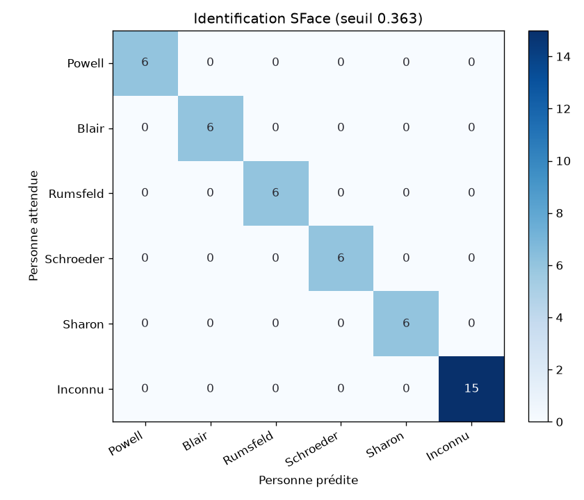
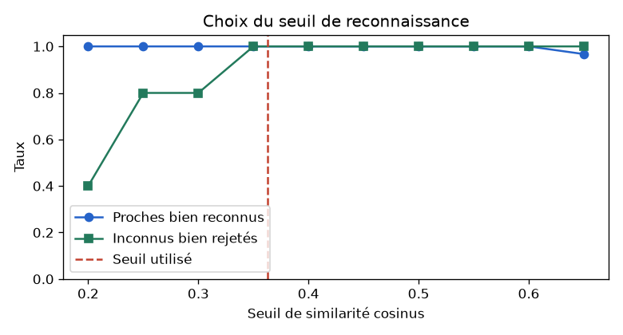

# Évaluation des IA du module Face

Rapport généré par `python manage.py evaluate_face` le 2026-10-28.
Jeux annotés : `MemoriA/Face/evaluation/` (scènes et protocole). Photos de visages : jeu public **Labeled Faces in the Wild** (LFW), téléchargé par scikit-learn, jamais mis dans Git. Valeurs brutes : `face_results.json`.

## 1. Détection des visages (YuNet) : Precision / Recall

**Méthode** : 20 photos de test, chacune formée de 4 vignettes : une photo LFW (1 visage) ou une scène sans personne (0 visage). On connaît donc la place de chaque visage. Une détection est un **vrai positif** si elle tombe dans une vignette avec visage (une seule fois), sinon c'est un **faux positif** ; une vignette avec visage sans détection est un **faux négatif**. Seuil de détection : 0.8.

**Correction de l'annotation** : la première évaluation a trouvé des détections « en trop » dans certaines photos LFW. Elles ont été dessinées sur les collages et vérifiées à l'œil : ce sont toutes de **vrais visages à l'arrière-plan** (personnes derrière ou à côté du sujet). Le rapport donne donc deux precisions : la stricte (1 seul visage par photo LFW) et la corrigée (visages d'arrière-plan vérifiés comptés comme justes).

| Mesure | Valeur |
|---|---|
| **Recall** (visages principaux trouvés) | **1.0** (42 sur 42) |
| **Precision corrigée** | **1.0** (F1 1.0) |
| Precision stricte | 0.824 (F1 0.903) |
| Visages d'arrière-plan vérifiés | 9 |
| Fausses alertes sur les 38 scènes sans personne | 0 |
| Temps moyen / maximum par photo (500 x 500) | 22 ms / 27 ms |

**Commentaire**

- Tous les visages principaux sont trouvés (recall 1.0) et aucune fausse alerte sur les scènes sans personne : YuNet est très fiable sur des visages de face, en quelques millisecondes.
- YuNet trouve même de petits visages flous à l'arrière-plan : dans l'application, ils apparaissent comme « Personne inconnue » et l'utilisateur peut les supprimer.

## 2. Identification des proches (SFace) : accuracy et matrice de confusion

**Méthode** : comme dans l'application, chacun des 5 proches est enregistré avec 3 photos (moyenne des empreintes SFace). On identifie ensuite 6 autres photos de chacun, plus 15 photos de 5 personnes jamais enregistrées, qui doivent être classées « Inconnu ». Seuil de similarité cosinus : 0.363 (valeur recommandée par OpenCV).

| Mesure | Valeur |
|---|---|
| **Accuracy (toutes les photos)** | **100 %** |
| Proches bien reconnus | 100 % |
| Inconnus bien rejetés | 100 % |
| Photos sans visage détecté | 0 |
| Regroupement DBSCAN des proches (Adjusted Rand Index, 1 = parfait) | 0.756 (4 groupes, 0 visages isolés) |
| Temps moyen par photo (détection + empreinte) | 13 ms |

### Choix du seuil

| Seuil | 0.2 | 0.25 | 0.3 | 0.35 | 0.4 | 0.45 | 0.5 | 0.55 | 0.6 | 0.65 |
|---|---|---|---|---|---|---|---|---|---|---|
| Proches reconnus | 1.0 | 1.0 | 1.0 | 1.0 | 1.0 | 1.0 | 1.0 | 1.0 | 1.0 | 0.967 |
| Inconnus rejetés | 0.4 | 0.8 | 0.8 | 1.0 | 1.0 | 1.0 | 1.0 | 1.0 | 1.0 | 1.0 |

**Commentaire**

- Avec le seuil 0.363, 100 % des proches sont reconnus et 100 % des inconnus sont rejetés.
- Un seuil plus haut rejette mieux les inconnus mais oublie plus de proches, un seuil plus bas fait l'inverse. Dans MémoriA, une erreur reste peu grave : l'application propose « C'est X ? » et l'utilisateur confirme.
- DBSCAN : un ARI de 0.756 montre que les groupes proposés correspondent bien aux vraies personnes.

## 3. Objets détectés (DETR) : précision

**Méthode** : 20 scènes dont les objets visibles ont été annotés à la main (`objets.json`). **Précision** = objets proposés corrects / objets proposés ; **rappel** = objets annotés trouvés / annotés.

**Correction de l'annotation** : comme pour les visages, les objets « en trop » ont été dessinés sur les images et vérifiés à l'œil. Plusieurs étaient vraiment visibles et avaient été oubliés à l'annotation (couteau, chaises et plantes du repas de famille, piétons près du bus…). En cas de doute, l'objet reste compté comme une erreur. Le rapport donne les deux précisions.

| Mesure | Valeur |
|---|---|
| **Précision corrigée** | **0.875** |
| Précision stricte (première annotation) | 0.714 |
| Rappel | 0.93 |
| Précision moyenne par scène | 0.791 |
| Moteur utilisé | DETR (local) |
| Temps moyen / maximum | 2.2 s / 2.6 s |

| # | Objets annotés | Objets proposés | Visibles, ajoutés après vérification | Vraies erreurs | Oubliés |
|---|---|---|---|---|---|
| 1 | chat, canapé | chat, canapé | — | — | — |
| 2 | chien, ballon | chien, ballon | — | — | — |
| 3 | clavier, tasse, table | clavier, tasse | — | — | table |
| 4 | vélo | vélo | — | — | — |
| 5 | pizza, verre à vin, table, fourchette | verre à vin, pizza, table, fourchette, couteau | couteau | — | — |
| 6 | voiture | voiture, camion | — | camion | — |
| 7 | personne, parapluie | personne, parapluie | — | — | — |
| 8 | gâteau | gâteau, table | — | table | — |
| 9 | personne, table, verre à vin, bol | personne, verre à vin, bol, table, plante, fourchette, chaise, vase | chaise, fourchette, plante, vase | — | — |
| 10 | bateau | bateau | — | — | — |
| 11 | réfrigérateur, four, micro-ondes, évier | réfrigérateur, évier, four, plante, bouteille | plante | bouteille | micro-ondes |
| 12 | banane, pomme, bol | bol, banane, pomme, table | table | — | — |
| 13 | personne, livre, chaise | personne, livre, banc, sac à main | — | banc, sac à main | chaise |
| 14 | cheval | cheval | — | — | — |
| 15 | bus, feu de circulation | bus, personne, feu de circulation | personne | — | — |
| 16 | lit | lit, plante | — | plante | — |
| 17 | personne, ours en peluche | ours en peluche, personne | — | — | — |
| 18 | personne, téléphone, voiture | personne, voiture, téléphone | — | — | — |
| 19 | bouteille | bouteille | — | — | — |
| 20 | télévision, plante | plante, télévision, canapé, vase | vase | canapé | — |

**Commentaire**

- Précision corrigée de 0.875 : la grande majorité des objets proposés sont vraiment sur la photo.
- Les vraies erreurs sont surtout des **confusions entre objets proches** (la voiture vue comme un camion, la chaise vue comme un banc) ou de très petits objets.
- Rappel de 0.93 : les objets annotés sont presque tous trouvés.

## 4. Légendes (BLIP) : évaluation qualitative

**Méthode** : BLIP décrit les 20 scènes, puis la légende est traduite en français. Deux mesures :

- **automatique** : le CLIP score (100 x similarité entre l'image et la légende anglaise), comparé au score de la description qui a servi à créer l'image (référence) ;
- **humaine** : une note de 1 à 5 par l'équipe dans `face_legendes.csv`.

| Mesure | Valeur |
|---|---|
| CLIP score moyen des légendes BLIP | **30.84** |
| CLIP score moyen de la description de référence | 31.68 |
| Note humaine moyenne (sur 5) | à compléter (voir ci-dessous) |
| Moteur utilisé | BLIP (local) |
| Temps moyen / maximum | 2.1 s / 2.8 s |

| # | Légende (français) | CLIP |
|---|---|---|
| 1 | un chat est couché sur un canapé | 25.8 |
| 2 | un chien jouant avec une balle dans l'herbe | 31.37 |
| 3 | une tasse de café et un ordinateur portable sur une table en bois | 31.81 |
| 4 | un vélo garé au milieu d'un parc | 31.23 |
| 5 | deux assiettes avec pizza et vin sur eux | 31.03 |
| 6 | une voiture rouge garée devant une maison | 32.78 |
| 7 | une personne marchant sur la plage avec un parasol | 31.53 |
| 8 | un gâteau d'anniversaire avec des bougies et des décorations | 31.85 |
| 9 | une famille qui dîne ensemble | 26.98 |
| 10 | un bateau flotte dans l'eau au coucher du soleil | 31.6 |
| 11 | une cuisine avec armoires blanches et appareils électroménagers blancs | 30.46 |
| 12 | un bol de fruits et fruits sur une table | 31.1 |
| 13 | un homme assis dans une chaise lisant un livre | 31.5 |
| 14 | un cheval debout dans un champ d'herbe | 32.55 |
| 15 | un bus à deux étages à New York | 28.06 |
| 16 | une chambre avec un lit et une fenêtre | 27.23 |
| 17 | une petite fille tenant un ours en peluche | 34.29 |
| 18 | Une femme qui parle sur un téléphone portable | 30.88 |
| 19 | une bouteille d'eau assise au-dessus d'une roche | 28.82 |
| 20 | un salon avec une télévision et une plante | 35.95 |

**Commentaire**

- Les légendes BLIP obtiennent 30.84 contre 31.68 pour la description de référence (écart de 0.84) : elles décrivent presque aussi bien l'image.
- **Notes humaines** : remplissez la colonne `note_1_a_5` de `face_legendes.csv`, copiez le fichier dans `MemoriA/Face/evaluation/notes_legendes.csv` puis relancez `python manage.py evaluate_face --only legendes`.

## Limites de l'évaluation

- LFW contient surtout des personnalités photographiées de face par des photographes de presse : les photos de famille (profil, mauvaise lumière, flou) seront plus difficiles.
- Les scènes des objets et des légendes sont générées par SD-Turbo : des images nettes et simples.
- Les jeux sont petits : une erreur fait varier les pourcentages de plusieurs points.
- On peut remplacer ou compléter ces jeux par des photos de l'équipe (avec son accord), dans le même format.
