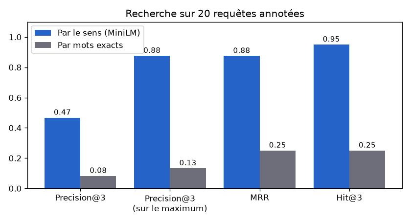
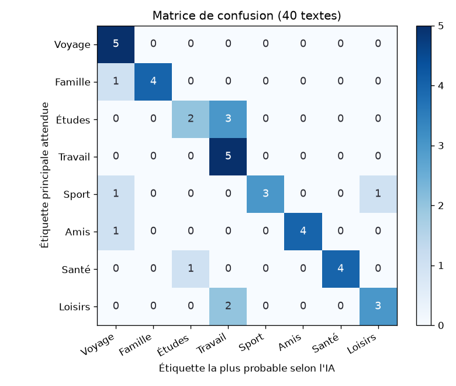
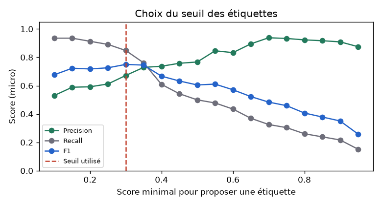

# Évaluation des IA du module Journal

Rapport généré par `python manage.py evaluate_journal` le 2026-10-28.
Jeux de données annotés : `MemoriA/Journal/evaluation/`. Valeurs brutes : `journal_results.json`.

## 1. Recherche par le sens (sentence-transformers) : Precision@3 et MRR

**Méthode** : 30 entrées de journal sont enregistrées pour un utilisateur de test et leurs **embeddings** sont calculés avec `paraphrase-multilingual-MiniLM-L12-v2` (modèle local, 384 dimensions). 20 requêtes sont écrites **avec d'autres mots** que les entrées (« une journée à la plage » pour une entrée qui parle de « sable » et de « nager »). Pour chaque requête, on a noté à la main les entrées pertinentes (1 à 3). La recherche classe les entrées par **similarité cosinus**.

- **Precision@3** : part des 3 premiers résultats qui sont pertinents.
- **MRR** (Mean Reciprocal Rank) : moyenne de 1 / rang de la première bonne entrée (1 = toujours en tête).
- **Hit@3** : part des requêtes avec au moins une bonne entrée dans les 3 premiers résultats.

| Mesure | Par le sens (IA) | Par mots exacts |
|---|---|---|
| **Precision@3** | **0.467** | 0.083 |
| Precision@3 maximale possible | 0.533 | 0.533 |
| **MRR** | **0.875** | 0.25 |
| Hit@3 | 0.95 | |
| Moteur | MiniLM (local) | recherche `icontains` |
| Temps moyen / maximum d'une recherche | 27 ms / 36 ms | |
| Calcul des 30 embeddings (chargement compris) | 10.9 s | |

| # | Requête | Pertinentes | 3 premiers (IA) | P@3 | 1/rang | 3 premiers (mots) |
|---|---|---|---|---|---|---|
| 1 | une journée à la plage | [1, 2] | [1, 15, 2] | 0.667 | 1.0 | [1, 21, 27] |
| 2 | j'avais un examen à l'université | [3, 30] | [23, 30, 3] | 0.667 | 0.5 | [3] |
| 3 | réunion de famille | [5, 6, 25] | [5, 6, 25] | 1.0 | 1.0 | [5, 10] |
| 4 | faire du sport | [7, 8, 26] | [26, 7] | 0.667 | 1.0 | [26] |
| 5 | mon travail en entreprise | [9, 10, 24] | [9, 24] | 0.667 | 1.0 | — |
| 6 | j'étais malade | [11] | [11, 29, 12] | 0.333 | 1.0 | [17] |
| 7 | je n'arrivais pas à trouver le sommeil | [12] | [12, 3, 27] | 0.333 | 1.0 | — |
| 8 | sortie culturelle et spectacle | [13, 14, 28] | [25, 14, 13] | 0.667 | 0.5 | — |
| 9 | partir en vacances loin de chez moi | [15, 16] | [8, 15, 16] | 0.667 | 0.5 | — |
| 10 | un conflit avec un ami | [17] | [17] | 0.333 | 1.0 | — |
| 11 | rire avec mes copains | [18] | [18, 5, 6] | 0.333 | 1.0 | — |
| 12 | préparer à manger | [19] | [19, 1] | 0.333 | 1.0 | [1, 4] |
| 13 | un animal de compagnie | [21] | [] | 0.0 | 0 | — |
| 14 | j'ai réussi mes études | [23] | [23, 9, 30] | 0.333 | 1.0 | [3] |
| 15 | chercher un emploi | [24] | [24, 9] | 0.333 | 1.0 | — |
| 16 | une fête de mariage | [25] | [25, 5] | 0.333 | 1.0 | [25] |
| 17 | le mauvais temps m'a gardé à l'intérieur | [27] | [27, 29, 12] | 0.333 | 1.0 | [8] |
| 18 | changer de logement | [29] | [29] | 0.333 | 1.0 | — |
| 19 | j'étais angoissé | [12, 30] | [12, 30, 14] | 0.667 | 1.0 | [17] |
| 20 | s'occuper des plantes | [22] | [22] | 0.333 | 1.0 | — |

**Commentaire**

- La bonne entrée arrive en tête pour 16 requêtes sur 20 (MRR 0.875) et dans les 3 premières pour 95 % des requêtes.
- La Precision@3 (0.467) est limitée par le jeu lui-même : beaucoup de requêtes n'ont qu'une entrée pertinente, le maximum possible est donc 0.533. Rapportée à ce maximum, elle vaut **0.876**.
- La recherche par mots exacts fait bien moins bien (MRR 0.25) : elle ne trouve rien quand la requête n'utilise pas les mêmes mots que l'entrée. C'est tout l'intérêt des embeddings.
- Requêtes les plus difficiles : « j'avais un examen à l'université », « sortie culturelle et spectacle », « partir en vacances loin de chez moi », « un animal de compagnie » (sens proche de plusieurs entrées, ou idée exprimée très différemment).
- Les embeddings sont calculés une seule fois (à l'enregistrement de l'entrée) et gardés dans `JournalEntry.embedding` : une recherche ne calcule que le vecteur de la requête, d'où un temps très court.

## 2. Suggestion d'étiquettes (zero-shot mDeBERTa) : Precision, Recall, F1

**Méthode** : un utilisateur de test possède 8 étiquettes (Voyage, Famille, Études, Travail, Sport, Amis, Santé, Loisirs). 40 textes de journal sont étiquetés à la main (5 par étiquette, certains en ont deux). Le modèle `MoritzLaurer/mDeBERTa-v3-base-mnli-xnli` donne un score à chaque étiquette (« Ce texte parle de {}. ») ; l'application propose les étiquettes dont le score dépasse **0.3**. Un texte pouvant avoir plusieurs étiquettes, les mesures sont calculées étiquette par étiquette (`MultiLabelBinarizer` + `classification_report`).

### Deux façons de calculer les scores

| Mode | Seuil | Precision | Recall | F1 micro |
|---|---|---|---|---|
| Chaque étiquette jugée seule (`multi_label=True`, première version) | 0.5 | 0.383 | 0.891 | 0.536 |
| Chaque étiquette jugée seule, meilleur seuil | 0.95 | 0.506 | 0.848 | 0.634 |
| **Scores partagés (`multi_label=False`, application)** | **0.3** | **0.672** | **0.848** | **0.75** |

La première version jugeait chaque étiquette **seule** : le modèle répond alors « oui » à presque tout (« Voyage », « Loisirs » et « Sport » à 1,00 pour le même texte) et l'application cochait trop d'étiquettes (precision faible). En mode **scores partagés**, les étiquettes sont mises en concurrence (la somme des scores vaut 1) : seules celles qui se détachent dépassent le seuil. **Attention** : ce changement et le seuil ont été choisis grâce à ce jeu de 40 textes, le résultat est donc un peu optimiste ; il faudrait le confirmer sur de nouveaux textes.

| Étiquette | Precision | Recall | F1 | Textes |
|---|---|---|---|---|
| Voyage | 0.56 | 1.0 | 0.71 | 5 |
| Famille | 1.0 | 0.86 | 0.92 | 7 |
| Études | 0.83 | 1.0 | 0.91 | 5 |
| Travail | 0.45 | 1.0 | 0.62 | 5 |
| Sport | 1.0 | 0.8 | 0.89 | 5 |
| Amis | 1.0 | 0.71 | 0.83 | 7 |
| Santé | 0.86 | 1.0 | 0.92 | 6 |
| Loisirs | 0.3 | 0.5 | 0.38 | 6 |
| **Micro (toutes les paires texte-étiquette)** | **0.672** | **0.848** | **0.75** | |
| Macro (moyenne des 8 étiquettes) | 0.75 | 0.859 | 0.774 | |

| Mesure | Valeur |
|---|---|
| Textes avec exactement les bonnes étiquettes | 20 / 40 |
| Étiquette la plus probable juste | 30 / 40 |
| Moteur utilisé | mDeBERTa zero-shot (local) |
| Temps moyen / maximum (modèle chargé) | 4371 ms / 4866 ms |
| Premier appel (chargement du modèle compris) | 13.7 s |

### Matrice de confusion

Lignes : l'étiquette principale annotée ; colonnes : l'étiquette qui a reçu le plus haut score. La diagonale = l'IA a mis la bonne étiquette en premier.

### Choix du seuil

| Seuil | 0.1 | 0.15 | 0.2 | 0.25 | 0.3 | 0.35 | 0.4 | 0.45 | 0.5 | 0.55 | 0.6 | 0.65 | 0.7 | 0.75 | 0.8 | 0.85 | 0.9 | 0.95 |
|---|---|---|---|---|---|---|---|---|---|---|---|---|---|---|---|---|---|---|
| Precision | 0.531 | 0.589 | 0.592 | 0.612 | 0.672 | 0.729 | 0.737 | 0.758 | 0.767 | 0.846 | 0.833 | 0.895 | 0.938 | 0.933 | 0.923 | 0.917 | 0.909 | 0.875 |
| Recall | 0.935 | 0.935 | 0.913 | 0.891 | 0.848 | 0.761 | 0.609 | 0.543 | 0.5 | 0.478 | 0.435 | 0.37 | 0.326 | 0.304 | 0.261 | 0.239 | 0.217 | 0.152 |
| F1 | 0.677 | 0.723 | 0.718 | 0.726 | 0.75 | 0.745 | 0.667 | 0.633 | 0.605 | 0.611 | 0.571 | 0.523 | 0.484 | 0.459 | 0.407 | 0.379 | 0.351 | 0.259 |

Règle fixée avant l'évaluation : le seuil au **meilleur F1 micro** (le plus haut en cas d'égalité). Seuil trouvé : **0.3** ; seuil utilisé par l'application : **0.3** (`TAG_THRESHOLD` dans `Journal/services.py`).

### Erreurs

| # | Texte | Attendues | Proposées |
|---|---|---|---|
| 1 | Nous avons pris le train de nuit pour Tozeur et dormi dans un hôtel au milieu des palmiers. | Voyage | Loisirs, Voyage |
| 3 | Week-end à Djerba avec mes parents, on a loué une maison près de la mer. | Famille, Voyage | Loisirs, Voyage |
| 5 | Road trip jusqu'à Tabarka avec la bande, musique à fond dans la voiture. | Amis, Voyage | Loisirs, Voyage |
| 9 | Dispute avec mes parents au sujet de mes sorties le soir. | Famille | Famille, Loisirs |
| 10 | Mon oncle est rentré du Canada, on a fêté son retour chez mes cousins. | Famille | Famille, Voyage |
| 13 | Toute la soirée à la bibliothèque pour finir mon mémoire de fin d'année. | Études | Travail, Études |
| 14 | Les résultats du semestre sont tombés, j'ai validé toutes mes matières. | Études | Travail, Études |
| 15 | Projet Django en équipe à l'université, on a enfin terminé les tests. | Études | Travail, Études |
| 21 | Dix kilomètres de course à pied autour du lac, nouveau record personnel. | Sport | Loisirs, Sport, Voyage |
| 23 | Match de football avec les voisins, nous avons gagné trois à un. | Amis, Sport | Sport |
| 24 | Cours de natation à la piscine municipale, j'arrive enfin à faire le crawl. | Sport | Loisirs, Sport |
| 25 | Randonnée de six heures dans les montagnes de Zaghouan. | Loisirs, Sport | Loisirs, Voyage |
| 26 | Soirée pizza chez Nadia avec tous mes copains de lycée. | Amis | Amis, Loisirs |
| 27 | Karim m'a appelé pour me remonter le moral, c'est un vrai ami. | Amis | Amis, Santé |
| 30 | Je me suis réconcilié avec Walid après notre dispute de la semaine dernière. | Amis | Amis, Voyage |
| 32 | Prise de sang ce matin à jeun, les résultats sont normaux. | Santé | Santé, Études |
| 35 | J'ai commencé un régime plus équilibré avec plus de légumes et moins de sucre. | Santé | Santé, Travail |
| 36 | J'ai regardé trois épisodes de ma série préférée sous la couverture. | Loisirs | — |
| 37 | Après-midi peinture à l'aquarelle sur le balcon, j'ai dessiné le coucher de soleil. | Loisirs | Travail |
| 39 | J'ai fini un roman policier passionnant en une seule nuit. | Loisirs | Travail |

**Commentaire**

- F1 micro de **0.75** (precision 0.672, recall 0.848). L'étiquette la plus probable est juste pour 30 textes sur 40 : le modèle comprend bien le sujet principal, sans aucun entraînement sur nos étiquettes.
- Étiquette la mieux reconnue : **Famille** (F1 0.92) ; la plus difficile : **Loisirs** (F1 0.38).
- Les erreurs viennent surtout des étiquettes larges (« Loisirs » touche aussi le sport, les sorties entre amis…) : le zero-shot donne un score élevé à plusieurs étiquettes proches.
- Les étiquettes ne sont que **proposées** (cases pré-cochées) : l'utilisateur décoche une erreur en un clic.

## Limites de l'évaluation

- 30 entrées et 20 requêtes, 40 textes : chaque erreur change les moyennes de plusieurs points.
- Les annotations sont faites par une seule personne ; certaines entrées pourraient répondre à plus de requêtes (une soirée triste après une dispute est aussi « angoissée »).
- Les textes sont courts et assez typiques ; un vrai journal mélange plusieurs sujets dans une même entrée.
