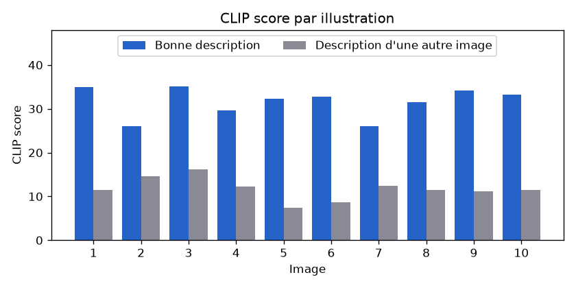
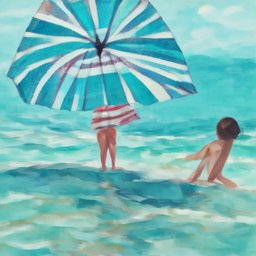
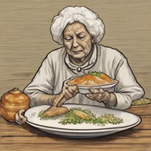
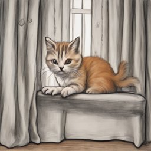
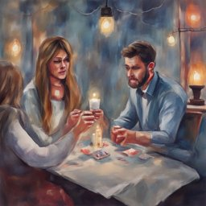
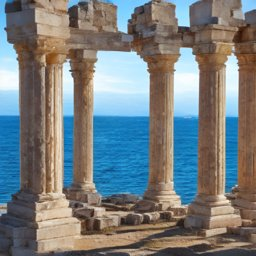
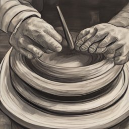
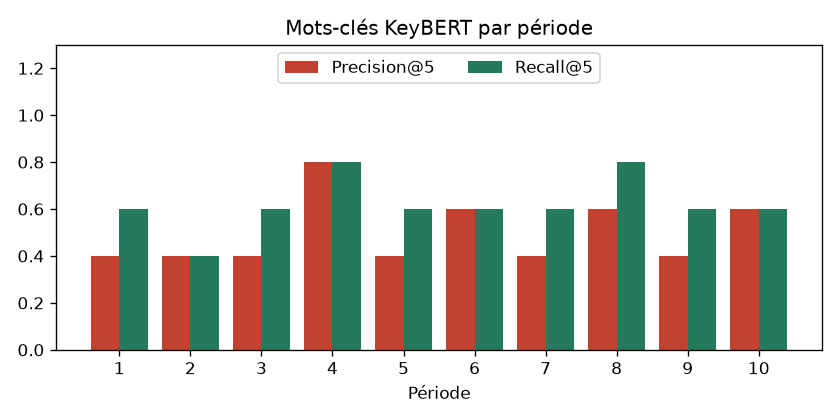

# Évaluation des IA du module Memory

Rapport généré par `python manage.py evaluate_memory` le 2026-10-27.
Jeux de données annotés : `MemoriA/Memory/evaluation/`. Valeurs brutes : `memory_results.json`.

## 1. Récit de la journée (Gemini) : grille qualitative

**Méthode** : Gemini écrit le récit de 15 entrées annotées (texte, note vocale, humeur), dans le style demandé. Chaque récit reçoit 3 notes sur 5 :

- **Fidélité** (automatique) : 1 + 4 x part des faits clés retrouvés, moins 1 point par élément inventé (liste d'éléments absents de l'entrée).
- **Longueur** (automatique) : 5 si le récit fait entre 120 et 250 mots (consigne du prompt), puis -1 par tranche de 15 % d'écart.
- **Style** : note donnée par un autre modèle, `gemini-3.5-flash-lite`, qui reçoit la même définition du style que le rédacteur (méthode « LLM-as-a-judge » ; un modèle différent évite qu'il juge son propre texte).

> **Résultats partiels** : 15 récit(s) sur 15 n'ont pas pu être générés (« Le quota gratuit de Gemini est atteint pour le moment. Réessayez plus tard (il se renouvelle chaque jour). »). Relancez `python manage.py evaluate_memory --only recits` quand le quota est renouvelé.

Aucun récit généré : vérifiez `GEMINI_API_KEY` et le quota.

## 2. Illustration (Stable Diffusion) : CLIP score

**Méthode** : 10 scènes sont illustrées par le moteur configuré (`IMAGE_BACKEND`). Le modèle CLIP (`openai/clip-vit-base-patch32`) mesure la correspondance entre l'image et sa description : **CLIP score = 100 x similarité cosinus**. Pour savoir si le score a un sens, on le compare au score de la même image avec la description d'une **autre** image (référence « hasard »).

| Mesure | Valeur |
|---|---|
| CLIP score moyen (bonne description) | **31.58** |
| CLIP score moyen (description d'une autre image) | 11.71 |
| Images mieux notées avec leur propre description | 10 / 10 |
| Moteur utilisé | SD-Turbo (local) |
| Temps moyen / maximum | 13.2 s / 31.8 s |

| # | Scène | Style | CLIP | CLIP (autre description) | Image |
|---|---|---|---|---|---|
| 1 | Two friends swimming in a calm turquoise sea under a striped beach umbrella | Aquarelle | 34.92 | 11.49 |  |
| 2 | A young intern sitting at a desk with a laptop in a bright modern office | Realiste | 26.1 | 14.66 |  |
| 3 | An old grandmother serving a large plate of fish couscous on a wooden table | Dessin | 35.16 | 16.2 |  |
| 4 | A crowded metro carriage stopped in a dark tunnel | Realiste | 29.56 | 12.29 |  |
| 5 | A wedding hall decorated with white jasmine flowers and people dancing | Aquarelle | 32.31 | 7.35 |  |
| 6 | Hikers resting on a rocky mountain summit overlooking a wide green plain | Realiste | 32.81 | 8.61 |  |
| 7 | A small ginger kitten climbing on long living room curtains | Dessin | 26.06 | 12.46 |  |
| 8 | A family playing cards by candlelight on a rainy evening | Aquarelle | 31.44 | 11.4 |  |
| 9 | Ancient Roman ruins with tall stone columns facing a blue sea | Realiste | 34.17 | 11.13 |  |
| 10 | Hands shaping a clay bowl on a spinning pottery wheel | Dessin | 33.26 | 11.46 |  |

**Commentaire**

- Score moyen de 31.58 : les images correspondent bien à leur description (au-dessus de 28, la correspondance est nette pour CLIP ViT-B/32).
- L'écart avec la référence « hasard » est de 19.87 points, et 10 images sur 10 sont mieux notées avec leur propre description : le score mesure bien le lien texte-image.
- Les images viennent du modèle local SD-Turbo (secours gratuit sur processeur, 512 x 512, 1 étape) : Stable Diffusion XL via Hugging Face donnerait des images plus détaillées.

## 3. Rétrospective (KeyBERT) : Precision@5 des thèmes

**Méthode** : pour 10 périodes annotées à la main (4 entrées et 5 thèmes attendus chacune), KeyBERT (modèle multilingue `paraphrase-multilingual-MiniLM-L12-v2`, mots vides français) extrait 5 mots-clés.

- **Precision@5 (stricte)** = part des 5 mots-clés corrects. Un mot-clé est correct si **tous** ses mots porteurs de sens appartiennent aux thèmes annotés (même racine, sans accents) : « robe mariée » est correct, « famille pleuré » ne l'est pas.
- **Precision@5 souple** (pour comparaison) : il suffit qu'un des mots touche un thème.
- **Recall@5** = part des thèmes attendus retrouvés parmi les mots-clés corrects.

| Mesure | Valeur |
|---|---|
| **Precision@5 moyenne (stricte)** | **0.5** |
| Precision@5 souple | 0.96 |
| Recall@5 moyen | 0.62 |
| Temps moyen / maximum (modèle déjà chargé) | 107 ms / 123 ms |
| Premier appel (chargement du modèle compris) | 13.6 s |

| # | Période | Mots-clés extraits | Corrects | P@5 | R@5 |
|---|---|---|---|---|---|
| 1 | Semaine de vacances à la mer | soleil plage, vacances poisson, sœur dîner, hammamet baignade, dauphins large | vacances poisson, sœur dîner | 0.4 | 0.6 |
| 2 | Semaine d'examens | mathématiques bibliothèque, fou examen, exercices problème, informatique soulagement, cafés | mathématiques bibliothèque, cafés | 0.4 | 0.4 |
| 3 | Mois du mariage d'Amira | robe mariée, famille pleuré, photos fête, musique danse, tantes mains | robe mariée, musique danse | 0.4 | 0.6 |
| 4 | Premier mois de stage | fonctionnalité django, stage startup, équipe codé, réunion client, projets personnels | fonctionnalité django, stage startup, équipe codé, réunion client | 0.8 | 0.8 |
| 5 | Semaine sportive | basket amis, piscine municipale, feu randonnée, club marche, soleil match | basket amis, club marche | 0.4 | 0.6 |
| 6 | Mois du déménagement | passé balcon, nouvel appartement, propriétaire déménagement, clés propriétaire, dîner | propriétaire déménagement, clés propriétaire, dîner | 0.6 | 0.6 |
| 7 | Semaine avec le nouveau chaton | chaton déchiré, visite vétérinaire, couscous dort, vaccins couscous, adoption chaton | couscous dort, vaccins couscous | 0.4 | 0.6 |
| 8 | Ramadan en famille | ramadan parents, ftour ramadan, visites oncles, dattes café, joué cartes | ramadan parents, ftour ramadan, dattes café | 0.6 | 0.8 |
| 9 | Voyage à Tozeur | chaleur désert, sahara décors, 4x4 dunes, tozeur train, fraîches excursion | 4x4 dunes, tozeur train | 0.4 | 0.6 |
| 10 | Semaine difficile | fièvre ordinateur, données retard, guéri tranquille, panne métro, jury compréhensif | fièvre ordinateur, données retard, panne métro | 0.6 | 0.6 |

**Commentaire**

- Precision@5 de 0.5 : plus de la moitié des thèmes sont pertinents.
- L'écart avec la mesure souple (0.96) vient des expressions de deux mots qui mélangent un thème et un mot sans rapport (ex. « famille pleuré ») : ce sont les erreurs typiques de KeyBERT avec des bigrammes.
- Recall@5 de 0.62 : en moyenne, 62 % des thèmes attendus sont retrouvés avec seulement 5 mots-clés.
- KeyBERT tourne en local (gratuit, sans quota) et répond en moins d'une seconde une fois le modèle chargé ; le modèle est préchargé au démarrage du worker Celery.

## Limites de l'évaluation

- Les jeux sont petits (15 récits, 10 images, 10 périodes) : les moyennes donnent une tendance, pas une mesure précise.
- La fidélité est mesurée par la présence de mots attendus : un fait reformulé autrement peut être compté absent.
- La note de style vient d'un modèle (Gemini juge Gemini) : elle doit être confirmée par les notes humaines.
- Le CLIP score mesure la correspondance texte-image, pas la beauté de l'image.
