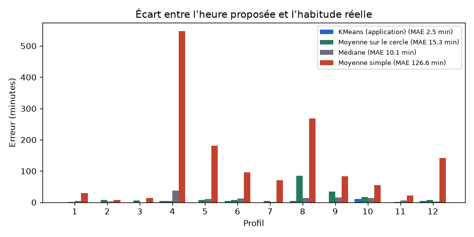
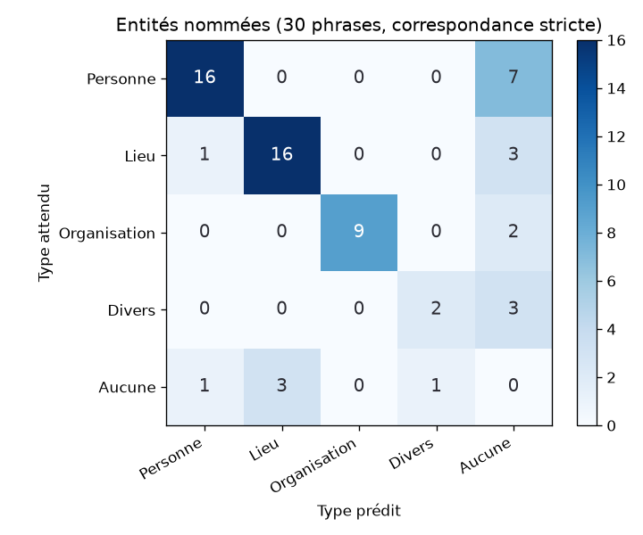
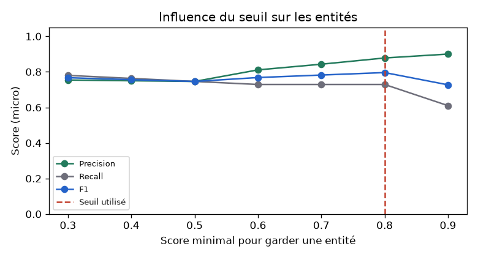

# Évaluation des IA du module Reminder

Rapport généré par `python manage.py evaluate_reminder` le 2026-10-28.
Jeux de données annotés : `MemoriA/Reminder/evaluation/`. Valeurs brutes : `reminder_results.json`.

## 1. Meilleure heure de rappel (KMeans) : erreur moyenne en minutes (MAE)

**Méthode** : 12 profils d'écriture simulés de 30 entrées (`heures.json`). Pour chacun, on connaît l'heure habituelle ; les heures réelles varient autour et une partie des entrées est écrite à n'importe quelle heure (bruit). L'application place chaque heure sur un cercle (23 h 55 et 0 h 05 sont voisines), regroupe les heures avec **KMeans** (1 à 3 groupes, choisis par le score de silhouette) et propose le centre du groupe le plus nombreux. On compare avec trois méthodes simples. **Plus la MAE est basse, mieux c'est.**

| Méthode | MAE (minutes) | Erreur maximale |
|---|---|---|
| **KMeans (application)** | **2.5** | 10 min |
| Moyenne sur le cercle | 15.3 | 85 min |
| Médiane | 10.1 | 37 min |
| Moyenne simple | 126.6 | 547 min |

| # | Profil | Habitude | KMeans | Erreur | Moyenne simple | Erreur |
|---|---|---|---|---|---|---|
| 1 | Étudiant du soir | 21:30 | 21:30 | 0 min | 21:00 | 30 min |
| 2 | Lève-tôt | 06:45 | 06:45 | 0 min | 06:53 | 8 min |
| 3 | Pause de midi | 12:40 | 12:40 | 0 min | 12:26 | 14 min |
| 4 | Couche-tard autour de minuit | 23:55 | 23:50 | 5 min | 14:48 | 547 min |
| 5 | Après minuit | 00:30 | 00:30 | 0 min | 03:32 | 182 min |
| 6 | Après le travail | 18:15 | 18:10 | 5 min | 16:39 | 96 min |
| 7 | Soirée régulière | 22:10 | 22:10 | 0 min | 20:59 | 71 min |
| 8 | Matin et soir (habitude principale le soir) | 21:00 | 21:05 | 5 min | 16:32 | 268 min |
| 9 | Irrégulier | 20:00 | 20:00 | 0 min | 18:36 | 84 min |
| 10 | Week-end matin | 10:30 | 10:40 | 10 min | 11:25 | 55 min |
| 11 | Dîner tardif | 23:20 | 23:20 | 0 min | 22:58 | 22 min |
| 12 | Avant le coucher | 22:45 | 22:50 | 5 min | 20:23 | 142 min |

**Commentaire**

- KMeans se trompe en moyenne de **2.5 minutes** et reste à moins de 15 minutes de l'habitude pour 12 profils sur 12. L'heure proposée est arrondie à 5 minutes, ce qui ajoute jusqu'à 2 minutes d'erreur.
- La **moyenne simple** (126.6 min) échoue complètement autour de minuit : 23 h 50 et 0 h 10 donnent une moyenne vers midi. Le passage sur le cercle corrige ce problème.
- La **moyenne sur le cercle** (15.3 min) est tirée par les entrées écrites au hasard et par une deuxième habitude (profil 8 : soir et matin). KMeans isole l'habitude principale.
- Calcul très rapide : 178 ms en moyenne, 1415 ms au maximum.

## 2. Question personnalisée : entités nommées (CamemBERT NER)

**Méthode** : 30 phrases de journal annotées à la main (59 entités : personnes PER, lieux LOC, organisations ORG, divers MISC). Le modèle `Jean-Baptiste/camembert-ner` analyse chaque phrase ; comme dans l'application, seules les entités de score ≥ 0.8 sont gardées. Une entité est **juste** si le texte (sans accents ni majuscules) **et** le type correspondent. En correspondance **partielle**, « lac de Tunis » trouvé comme « Tunis » compte aussi.

| Type | Precision | Recall | F1 | Entités | F1 partiel |
|---|---|---|---|---|---|
| PER (Personne) | 0.89 | 0.7 | 0.78 | 23 | 0.83 |
| LOC (Lieu) | 0.84 | 0.8 | 0.82 | 20 | 0.92 |
| ORG (Organisation) | 1.0 | 0.82 | 0.9 | 11 | 0.9 |
| MISC (Divers) | 0.67 | 0.4 | 0.5 | 5 | 0.5 |
| **Micro (toutes les entités)** | **0.878** | **0.729** | **0.796** | 59 | 0.852 |
| Macro (moyenne des 4 types) | 0.849 | 0.678 | 0.75 | | 0.788 |

| Mesure | Valeur |
|---|---|
| Phrases entièrement justes | 15 / 30 |
| Moteur utilisé | CamemBERT NER (local) |
| Temps moyen / maximum (modèle chargé) | 191 ms / 449 ms |
| Premier appel (chargement du modèle compris) | 8.2 s |

### Phrases avec au moins une erreur

| # | Phrase | Attendu | Trouvé |
|---|---|---|---|
| 1 | Ce matin, j'ai pris un café avec Sarah à Tunis. | PER Sarah, LOC Tunis | LOC Tunis |
| 2 | Karim et moi avons regardé le match de l'Espérance au stade de Radès. | PER Karim, ORG Espérance, LOC Radès | ORG Espérance, LOC Radès |
| 6 | Réunion à l'ESPRIT avec le professeur Ben Salah pour le projet Django. | ORG ESPRIT, PER Ben Salah, MISC Django | ORG ESPRIT, PER Ben Salah |
| 7 | Week-end à Djerba avec Leïla et Mehdi, il faisait très chaud. | LOC Djerba, PER Leïla, PER Mehdi | LOC Djerba, PER Mehdi |
| 10 | Grosse panne de la STEG dans tout le quartier ce soir. | ORG STEG | — |
| 11 | Nadia m'a invitée à son anniversaire à La Marsa. | PER Nadia, LOC La Marsa | LOC La Marsa |
| 12 | Randonnée au djebel Zaghouan avec le club Tunisie Trekking. | LOC Zaghouan, ORG Tunisie Trekking | LOC djebel Zaghouan, ORG Tunisie Trekking |
| 13 | Le concert d'Emel Mathlouthi au festival de Carthage était magnifique. | PER Emel Mathlouthi, MISC festival de Carthage | PER Emel Mathlouthi |
| 14 | Mon frère Ahmed a eu son bac au lycée Bourguiba de Monastir. | PER Ahmed, ORG lycée Bourguiba, LOC Monastir | PER Ahmed, LOC lycée, LOC Monastir |
| 21 | Balade au bord du lac de Tunis avec mon chien Rex. | LOC lac de Tunis, PER Rex | LOC lac de Tunis |
| 22 | Nous préparons la Coupe du monde de football devant la télévision avec Walid. | MISC Coupe du monde, PER Walid | MISC la Coupe, PER Walid |
| 23 | Visite du musée du Bardo avec la classe de Mme Trabelsi. | LOC musée du Bardo, PER Trabelsi | LOC musée du Bardo, PER Mme Trabelsi |
| 24 | J'ai rencontré Claire, une amie française, à l'aéroport de Tunis-Carthage. | PER Claire, LOC Tunis-Carthage | LOC de Tunis-Carthage |
| 25 | Session de révision à la bibliothèque nationale avec Hichem. | LOC bibliothèque nationale, PER Hichem | PER Hichem |
| 26 | Le Club Africain a gagné le derby, tout Bab Jedid faisait la fête. | ORG Club Africain, LOC Bab Jedid | ORG Club Africain, PER Bab Jedid |

### Influence du seuil

| Seuil | 0.3 | 0.4 | 0.5 | 0.6 | 0.7 | 0.8 | 0.9 |
|---|---|---|---|---|---|---|---|
| Precision | 0.754 | 0.75 | 0.746 | 0.811 | 0.843 | 0.878 | 0.9 |
| Recall | 0.78 | 0.763 | 0.746 | 0.729 | 0.729 | 0.729 | 0.61 |
| F1 | 0.767 | 0.756 | 0.746 | 0.768 | 0.782 | 0.796 | 0.727 |

Le meilleur F1 sur ces phrases est obtenu avec un seuil de **0.8** (F1 0.796) ; le seuil de l'application (0.8) donne F1 0.796 et precision 0.878. Le seuil **n'a pas été ajusté sur ce jeu de test** (le résultat serait alors trop optimiste) : il a été fixé avant l'évaluation pour privilégier la **precision**, car une question qui cite un mot qui n'est pas un nom (un prénom rangé dans « divers », par exemple) gêne plus qu'une question générale. En dessous de 0,6, le modèle ajoute des entités fausses ; au-dessus de 0,8, il oublie des prénoms.

**Commentaire**

- F1 global (micro) de **0.796** en correspondance stricte et 0.852 en correspondance partielle.
- Le type le mieux reconnu est **ORG** (F1 0.9) ; le plus difficile est **MISC** (F1 0.5). Pour la question du jour, ce sont surtout les **personnes** et les **lieux** qui comptent (ils passent en premier dans `build_question`).
- Les erreurs viennent surtout des frontières (« lac de Tunis » réduit à « Tunis ») et des types ambigus (un club, un festival, un animal) : la question posée reste naturelle même dans ces cas.
- Si l'IA échoue ou ne trouve rien, l'application pose une question générale : l'utilisateur a toujours une question du jour.

## Limites de l'évaluation

- Les heures d'écriture sont **simulées** (graine fixe) : de vrais utilisateurs ont des habitudes qui changent selon les jours (semaine / week-end), ce que le modèle ne distingue pas encore.
- 30 phrases annotées par une seule personne : une entité de plus ou de moins change le F1 d'un type de plusieurs points, surtout pour MISC (peu d'exemples).
- La frontière entre types est parfois discutable (un festival est-il un lieu ou un événement ?) : c'est pourquoi la correspondance partielle est donnée à côté de la correspondance stricte.
