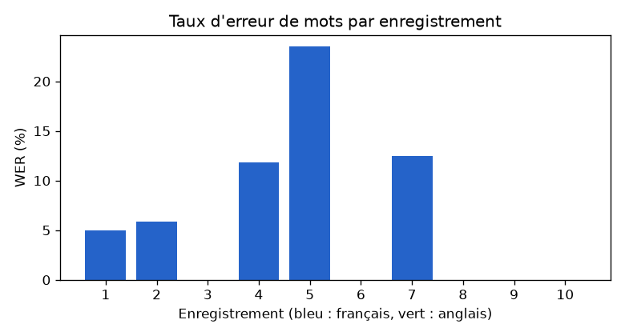
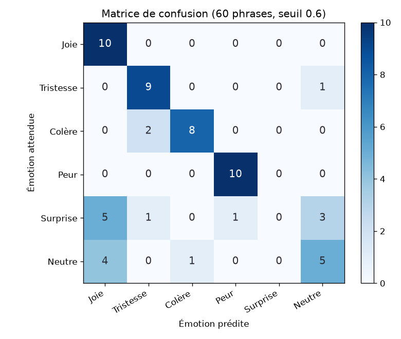
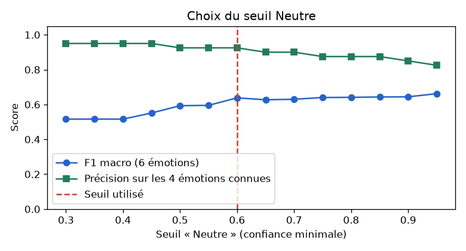

# Évaluation des IA du module Voice

Rapport généré par `python manage.py evaluate_voice` le 2026-10-27.
Jeux de données annotés : `MemoriA/Voice/evaluation/`. Valeurs brutes : `voice_results.json`.

## 1. Transcription (Whisper) : taux d'erreur de mots (WER)

**Méthode** : 10 enregistrements dont on connaît le texte exact (7 en français, 3 en anglais) sont transcrits par le moteur configuré (`VOICE_BACKEND`). Le **WER** compte les mots remplacés, oubliés ou ajoutés, divisés par le nombre de mots du texte de référence (bibliothèque `jiwer`). Avant le calcul, les deux textes sont mis en minuscules et sans ponctuation. **Plus le WER est bas, mieux c'est** (0 % = transcription parfaite).

| Mesure | Valeur |
|---|---|
| **WER moyen** | **5.9 %** |
| WER global (toutes les erreurs / tous les mots) | 6.0 % |
| WER en français / en anglais | 8.4 % / 0.0 % |
| Langue détectée correctement | 10 / 10 |
| Moteur utilisé | Whisper (local) |
| Temps moyen / maximum (modèle chargé) | 7.2 s / 8.0 s |
| Premier appel (chargement du modèle compris) | 44.7 s |

| # | Langue | Référence | Transcription | WER |
|---|---|---|---|---|
| 1 | fr | Aujourd'hui je suis allé à la plage avec mes amis. Il faisait très beau et nous avons beaucoup ri. | Aujourd'hui je suis allé à la plage avec mes amis. Il faisait très beau et nous avons beaucoup ré. | 5 % |
| 2 | fr | Ce matin j'ai raté le bus et je suis arrivé en retard au cours de mathématiques. | Ce matin, j'ai raté le but et je suis arrivé en retard au cours de mathématiques. | 6 % |
| 3 | fr | Ma grand-mère a préparé un couscous au poisson pour toute la famille. C'était délicieux. | Ma grand-mère a préparé un couscous au poisson pour toute la famille. C'était délicieux. | 0 % |
| 4 | fr | J'ai peur de la soutenance de demain. Je vais encore relire mes diapositives avant de dormir. | J'ai peur de la soutenance de demain. Je vais encore relire médiapositive avant de dormir. | 12 % |
| 5 | fr | Nous avons visité les ruines de Carthage puis nous avons bu un thé à Sidi Bou Saïd. | Nous avons visité les ruines de cartage puis nous avons bu un thé à sidiboussaïde. | 24 % |
| 6 | fr | Le médecin m'a conseillé de me reposer pendant trois jours et de boire beaucoup d'eau. | Le médecin m'a conseillé de me reposer pendant trois jours et de boire beaucoup d'eau. | 0 % |
| 7 | fr | Mon frère a eu son baccalauréat avec mention bien. Ma mère était tellement fière de lui. | Mon frère a eu son bacaloria avec mention bien. Ma mère était tellement fier de lui. | 12 % |
| 8 | en | Today I started my internship at a software company. My tutor showed me the whole team. | Today I started my internship at a software company. My tutor showed me the whole team. | 0 % |
| 9 | en | It rained all afternoon so I stayed home and read a novel with a cup of coffee. | It rained all afternoon so I stayed home and read a novel with a cup of coffee. | 0 % |
| 10 | en | We won the football match in the last minute and everybody was shouting with joy. | We won the football match in the last minute and everybody was shouting with joy. | 0 % |

**Commentaire**

- WER moyen de 5.9 % : moins d'un mot faux sur dix, la transcription est fiable pour un journal. Les erreurs sont visibles dans le tableau ci-dessus : surtout des noms propres et des mots proches à l'oral (homophones).
- Le moteur utilisé est **Whisper base en local** (secours gratuit, 74 millions de paramètres). Whisper large-v3 via Hugging Face (1,5 milliard de paramètres) ferait moins d'erreurs.
- La langue est reconnue dans 10 cas sur 10.

## 2. Détection d'émotion (xlm-emo-t) : Precision, Recall, F1

**Méthode** : 60 phrases de journal étiquetées à la main, 10 par émotion de `MoodRecord`. Le modèle `MilaNLProc/xlm-emo-t` ne connaît que **4 émotions** (joie, tristesse, colère, peur). Règle de l'application : si sa confiance est inférieure au **seuil Neutre (0.6)**, l'humeur est « Neutre ». Il ne peut jamais prédire « Surprise ».

| Émotion | Precision | Recall | F1 | Phrases |
|---|---|---|---|---|
| Joie | 0.53 | 1.0 | 0.69 | 10 |
| Tristesse | 0.75 | 0.9 | 0.82 | 10 |
| Colère | 0.89 | 0.8 | 0.84 | 10 |
| Peur | 0.91 | 1.0 | 0.95 | 10 |
| Surprise | 0.0 | 0.0 | 0.0 | 10 |
| Neutre | 0.56 | 0.5 | 0.53 | 10 |
| **Moyenne macro** | **0.605** | **0.7** | **0.638** | 60 |

| Mesure | Valeur |
|---|---|
| Accuracy (6 émotions) | 70 % |
| Accuracy sur les 4 émotions connues du modèle | 92 % |
| Moteur utilisé | Émotions (local) |
| Temps moyen / maximum (modèle chargé) | 315 ms / 534 ms |
| Premier appel (chargement du modèle compris) | 31.0 s |

### Choix du seuil « Neutre »

Pour chaque seuil de 0,30 à 0,95, on calcule le F1 macro **et** la précision sur les 4 émotions connues. Un seuil très haut améliore un peu le F1 macro sur ces 60 phrases mais transforme de vraies émotions modérées en « Neutre ». Règle retenue, avec un objectif fixé à l'avance : **le meilleur F1 macro parmi les seuils qui gardent au moins 90 % de bonnes réponses sur les 4 émotions connues**. Seuil choisi : **0.6** ; seuil utilisé par l'application : **0.6** (`NEUTRAL_THRESHOLD` dans `Voice/services.py`).

| Seuil | 0.3 | 0.35 | 0.4 | 0.45 | 0.5 | 0.55 | 0.6 | 0.65 | 0.7 | 0.75 | 0.8 | 0.85 | 0.9 | 0.95 |
|---|---|---|---|---|---|---|---|---|---|---|---|---|---|---|
| F1 macro | 0.516 | 0.516 | 0.516 | 0.551 | 0.593 | 0.595 | 0.638 | 0.627 | 0.63 | 0.64 | 0.641 | 0.643 | 0.644 | 0.662 |
| Précision 4 émotions | 0.95 | 0.95 | 0.95 | 0.95 | 0.925 | 0.925 | 0.925 | 0.9 | 0.9 | 0.875 | 0.875 | 0.875 | 0.85 | 0.825 |

### Erreurs du modèle

| # | Phrase | Attendu | Prédit | Confiance |
|---|---|---|---|---|
| 20 | Je regarde les vieilles photos de l'école et j'ai le cafard. | Tristesse | Neutre | 0.47 |
| 23 | Trois heures d'attente à l'administration pour qu'on me dise de revenir demain, c'est révoltant. | Colère | Tristesse | 0.67 |
| 27 | Le magasin refuse de me rembourser un produit cassé, quelle honte ! | Colère | Tristesse | 0.91 |
| 41 | Je ne m'attendais pas du tout à croiser mon ancien professeur à Paris ! | Surprise | Joie | 0.81 |
| 42 | En ouvrant la porte, toute la classe était là pour me faire une surprise. | Surprise | Joie | 0.98 |
| 43 | Incroyable, il a neigé à Tunis ce matin, du jamais vu ! | Surprise | Peur | 0.65 |
| 44 | Mon frère m'a annoncé qu'il se mariait le mois prochain, je suis resté bouche bée. | Surprise | Tristesse | 0.73 |
| 45 | J'ai trouvé un billet de cinquante dinars dans une vieille veste, quelle surprise. | Surprise | Neutre | 0.52 |
| 46 | Le prof a annulé l'examen à la dernière minute, personne n'y croyait. | Surprise | Neutre | 0.55 |
| 47 | Je découvre que ma voisine est une chanteuse connue, je n'en reviens pas. | Surprise | Joie | 0.78 |
| 48 | Contre toute attente, notre petit club a battu le champion en titre. | Surprise | Joie | 0.98 |
| 49 | Mon père, qui déteste la technologie, m'a envoyé son premier message vocal, étonnant ! | Surprise | Joie | 0.99 |
| 50 | On m'a proposé un stage à l'étranger alors que je n'avais même pas postulé. | Surprise | Neutre | 0.52 |
| 53 | J'ai fait les courses : du pain, du lait et des tomates. | Neutre | Joie | 0.99 |
| 54 | Réunion d'équipe de dix heures à onze heures sur le planning du mois. | Neutre | Joie | 0.95 |
| 57 | Il faisait vingt degrés aujourd'hui avec quelques nuages. | Neutre | Joie | 0.86 |
| 58 | J'ai mis à jour mon ordinateur et changé le mot de passe du wifi. | Neutre | Colère | 0.72 |
| 59 | Ma mère a préparé une soupe pour le dîner, ensuite j'ai lu un peu. | Neutre | Joie | 0.93 |

**Commentaire**

- Sur les 4 émotions qu'il connaît, le modèle a raison dans 92 % des cas : il est fiable pour la joie, la tristesse, la colère et la peur.
- Le F1 macro sur les 6 émotions (0.638) est tiré vers le bas par **Surprise** (F1 = 0, le modèle n'a pas cette classe) : une surprise est classée en joie, en peur ou en neutre.
- La precision la plus basse est celle de **Joie** (0.53) : les phrases d'autres catégories (surprises, phrases banales) qui ne rentrent dans aucune des 4 classes finissent souvent en joie.
- **Neutre** : recall 0.5, precision 0.56. Le modèle reste souvent très confiant même sur une phrase banale ; le seuil ne rattrape qu'une partie de ces cas.
- Piste d'amélioration : un modèle à 6 ou 7 émotions (avec surprise et neutre), ou laisser l'utilisateur corriger l'émotion (déjà possible : l'humeur est modifiable).

## Limites de l'évaluation

- Les enregistrements sont produits par les voix de synthèse de Windows : une voix nette, sans bruit ni accent. Le WER sur de vraies notes vocales (micro de téléphone, bruit, accent) sera plus élevé. Pour le mesurer, remplacez les fichiers de `evaluation/audio/` par de vrais enregistrements du même texte.
- 60 phrases (10 par émotion) : les pourcentages par classe varient de 10 points pour une seule erreur.
- Les phrases sont courtes et assez claires ; un vrai journal mélange souvent plusieurs émotions.
